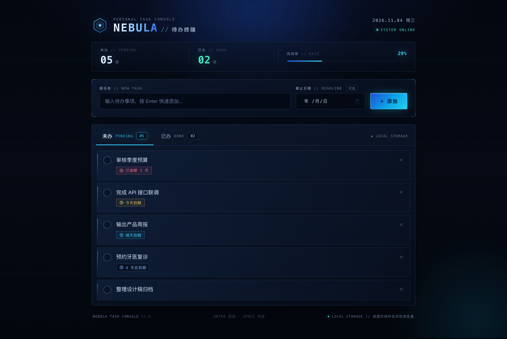

# dsh-superagent-project

Test repository for a locally deployed DeepSeek Super-agent.

Agent changes are delivered on task branches through pull requests. Merging remains manual.

## 项目用途

本仓库是本地部署的 DeepSeek Super-agent 的测试仓库，用于验证 agent 的完整工作流程：agent 根据测试需求在独立的任务分支上完成改动并创建 Pull Request，由人工审核和合并。

仓库中的需求与改动仅用于流程测试，不代表真实产品或业务项目。

## 如何提交测试需求

1. 在本仓库的 Issues 中新建 Issue，标题简要说明需要完成的改动。
2. 在正文中写明期望 agent 做的事情，例如要修改的文件和期望的结果，并 @willzhai 通知 agent。
3. agent 会在独立分支上提交 Pull Request；请人工审核，确认无误后由人工合并。

## 待办应用：NEBULA // 待办终端

仓库根目录包含一个零依赖的本地待办应用，围绕本仓库的 agent 交付流程构建。



### 功能

- **未办 / 已办两个 Tab**：实时显示两类任务数量、完成项数与完成率。
- **新增待办**：输入任务标题后按 `Enter` 或点击“添加”；截止日期（deadline）可选。
- **完成、恢复与删除**：点击任务左侧圆点标记完成；在已办 Tab 中可恢复为未办或删除任务。
- **智能排序**：未办按截止日期由近及远排列（无截止日期排最后），已办按完成时间倒序。
- **截止日期提示**：今天到期 / 明天到期 / N 天后到期 / 已逾期，按紧迫程度高亮。
- **本地持久化**：数据保存在浏览器 `localStorage`，刷新页面不会丢失，并支持多窗口同步。
- **键盘与响应式**：方向键切换 Tab，桌面、平板与手机布局均可用，并遵循“减少动态效果”系统偏好。

### 本地运行

需要 Node.js 18+。应用使用 ES Module，需通过 HTTP 访问，不能直接双击 `index.html`。

```bash
npm start   # 零依赖静态服务器，默认 http://127.0.0.1:8080
npm test    # 运行 todo-core.js 的单元测试（Node 内置 test runner）
```

也可以使用任意静态服务器：

```bash
python3 -m http.server 8080
```

### 文件结构

```text
index.html              页面结构
styles.css              蓝黑科技感样式与响应式布局
app.js                  页面交互、渲染与 localStorage 持久化
todo-core.js            纯任务逻辑（排序、统计、deadline 格式化、存储解析）
server.mjs              零依赖本地静态服务器
tests/todo-core.test.mjs 核心逻辑单元测试
docs/screenshots/       界面截图
```
